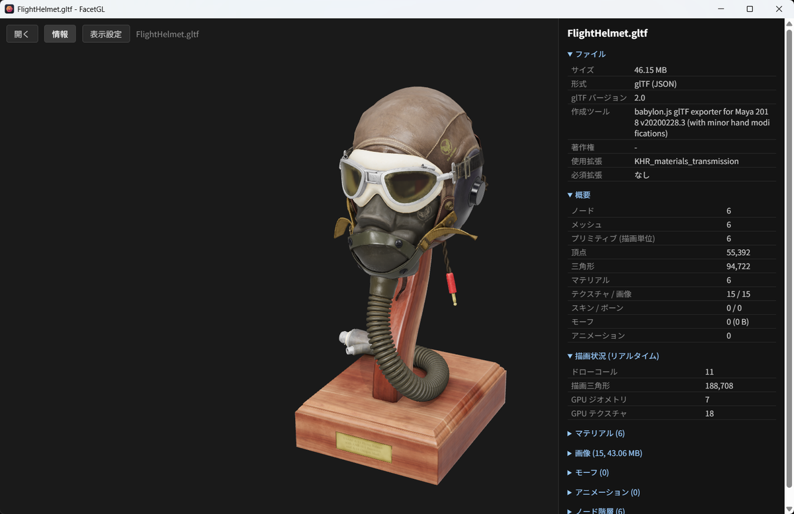
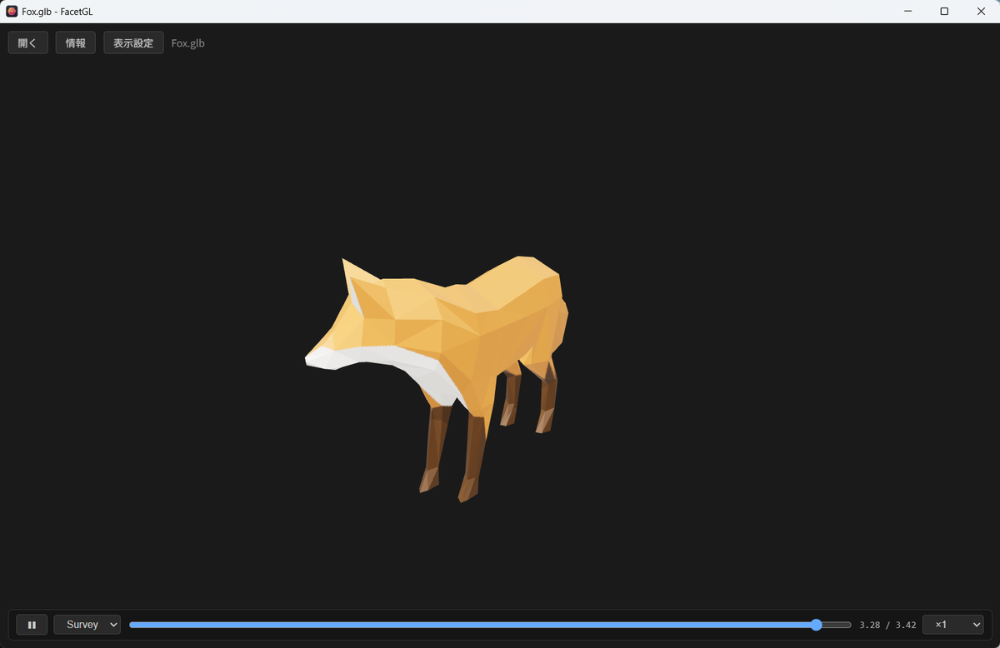
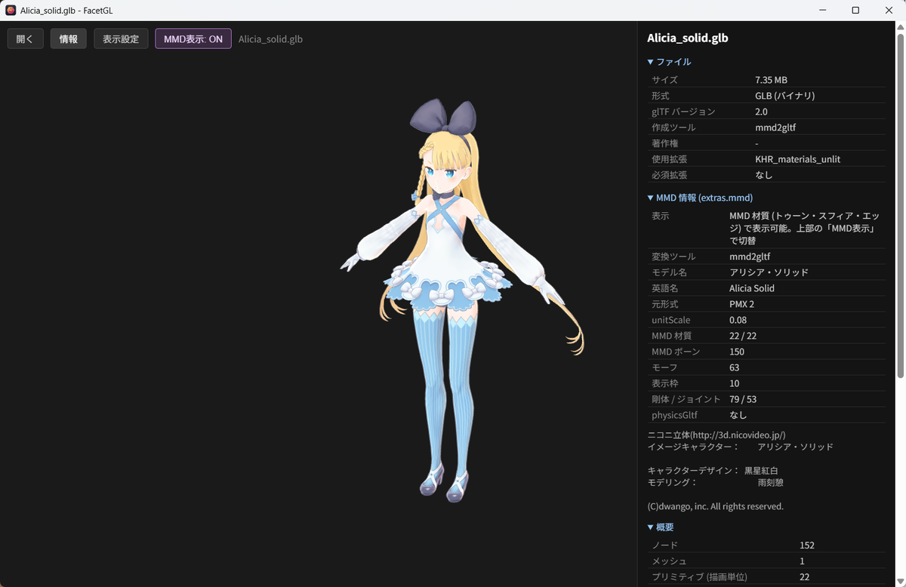

# FacetGL

**日本語** | [English](README.en.md)

glTF / GLB を中心に、VRM・MMD (PMX/PMD)・FBX・OBJ・STL を開ける Windows / macOS 向けの 3D モデルビューアです。
[Tauri](https://tauri.app/) と [three.js](https://threejs.org/) で作られています。

**🌐 Web 版: <https://masaka1024.github.io/facetgl/>** — インストール不要。ブラウザにモデルをドロップするだけで開けます
(ファイルはブラウザ内だけで読み込まれ、どこにも送信されません)。





## 特徴

- **ドラッグ＆ドロップ / 「開く」 / ダブルクリック** でモデルを開く (`.glb` `.gltf` `.vrm` を関連付け)
- **外部ファイル対応**: `.gltf` の `.bin` やテクスチャ、PMX/FBX/OBJ のテクスチャを同じフォルダから自動で読む。
  参照先に無いテクスチャは、モデルのフォルダとその上 (最大3つ上) のフォルダから同名ファイルを探して補う (近い場所を優先、ホームフォルダより上は探さない)
- **アニメーション再生**: 再生/一時停止、シーク、速度変更 (glTF / FBX)
- **MMD モーション (VMD)**: PMX / PMD を開いたあとに VMD をドロップ (または「開く」) すると再生。IK・付与親に対応し、物理演算と組み合わせて踊らせられる
- **情報パネル**: ファイルサイズ、頂点・三角形・材質・ボーン・モーフ数、テクスチャ一覧、ノード階層、描画状況、
  読み込めなかったファイル、VRM の利用条件
- **MMD 表示**: PMX/PMD を MMD と同じ式でシェーディング (トゥーン・スフィア・エッジ)
- **物理演算 (試験機能)**: PMX と、mmd2gltf で変換した glTF の髪やスカートを物理で揺らせる (`Alt` + ドラッグでモデルを動かす)。
  MMD の挙動に合わせた自作の Bullet 2.75 互換エンジンで計算
- **mmd2gltf の `extras.mmd` に対応**: 変換済み GLB も MMD 表示で開け、glTF 標準表示と切り替え可能
- **表示設定**: 透視 / 平行投影、視野角、輪郭線の太さ
- 圧縮 glTF (Draco / KTX2 / Meshopt) に対応

## 対応形式

| 形式 | 拡張子 | 備考 |
|---|---|---|
| glTF 2.0 | `.glb` `.gltf` | Draco / KTX2 / Meshopt、`extras.mmd` |
| VRM | `.vrm` | 0.x / 1.0 |
| MMD | `.pmx` `.pmd` | モーション `.vmd` (モデルを開いたあとに読み込む)。物理演算は PMX のみ (glTF は mmd2gltf で変換したもの) |
| FBX | `.fbx` | バイナリ / ASCII (7.0 以降) |
| OBJ | `.obj` | `.mtl` とテクスチャを同じフォルダから読み込み |
| STL | `.stl` | Z 軸が上の向きとして表示 |

## Web 版

<https://masaka1024.github.io/facetgl/> でそのまま使えます。デスクトップ版と同じ表示・機能です。

- PMX / FBX / OBJ のようにテクスチャが別ファイルのモデルや、外部ファイルを参照する `.gltf` は、
  **フォルダごとドロップ** (または「フォルダを開く」) してください。GLB / VRM は1ファイルで開けます
- **物理演算と MMD モーション (VMD) も Web 版で使えます**。PMX をフォルダごと開いたあと、
  VMD ファイルを1つドロップ (または「開く」) すると、そのモデルで再生されます
- 物理演算の速さはブラウザと PC によります。現在の Chrome / Edge / Firefox / Safari (15 以降) では
  WebAssembly で高速に計算します (使えない環境でも、同じ結果のまま少し遅く動きます)
- ブラウザの仕組み上、ファイルは開くたびにドロップ (または選択) が必要です
- デスクトップ版にしかない機能: ファイルの関連付け (ダブルクリックで開く)、PC や NAS 上のファイルをパスで直接読むこと

## インストール (デスクトップ版)

[Releases](https://github.com/masaka1024/facetgl/releases) から `FacetGL_x.y.z_x64-setup.exe` をダウンロードして実行してください。

### Windows

電子署名をしていないため、初回は「Windows によって PC が保護されました」と表示されることがあります。
「詳細情報」→「実行」で進めてください。

### macOS (11 Big Sur 以降、Apple Silicon / Intel 共通)

1. [Releases](https://github.com/masaka1024/facetgl/releases) から `FacetGL_x.y.z_universal.dmg` をダウンロードして開きます
2. `FacetGL` を「アプリケーション」フォルダへドラッグします
3. Apple の公証 (Notarization) を受けていないため、初回は「開けません」と表示されます。
   一度ダイアログを閉じてから **システム設定 → プライバシーとセキュリティ** を開き、
   下のほうに出る「FacetGL」の **「このまま開く」** を押してください (2回目以降はそのまま起動できます)

うまくいかない場合は、ターミナルで次を実行してから開いてください。

```sh
xattr -dr com.apple.quarantine /Applications/FacetGL.app
```

## 操作

| 操作 | 内容 |
|---|---|
| 左ドラッグ / 右ドラッグ / ホイール | 回転 / 平行移動 / ズーム |
| `Ctrl+O` (Mac は `⌘O`) | ファイルを開く (モデル、または開いている MMD モデル用のモーション) |
| `Space` | アニメーションの再生 / 一時停止 |
| `I` | 情報パネルの表示 / 非表示 |
| `P` | 透視 / 平行投影の切り替え |
| `F` | 物理演算の ON / OFF (PMX / mmd2gltf の glTF、試験機能) |
| `R` | 物理リセット (姿勢を初期状態に戻してやり直す) |
| `Alt` + ドラッグ (Mac は `option` + ドラッグ) | 物理 ON のとき、モデルを動かして髪やスカートを揺らす (離すと元の位置に戻る) |

## MMD 表示について

PMX/PMD と、mmd2gltf が出力する `extras.mmd` 付きの glTF は、MMD のシェーディングを再現して描画します。



```
color = saturate(拡散色 × ライト色 + 環境色) × テクスチャ  (+ / × スフィア)
color = color × トゥーン(N·L) + スペキュラ × ライト色 × pow(N·H, 反射強度)
```

- 計算は MMD と同じく sRGB 空間で行い、ライト色は MMD の初期値 (154, 154, 154)
- トゥーンは LINEAR・CLAMP・ミップマップなしで参照 (MMD と同じ)
- スフィアは view 空間の法線で参照 (`u = N.x·0.5+0.5`, `v = 0.5−N.y·0.5`)
- 輪郭線は「エッジサイズ × 設定値」ピクセル (初期値 1.0 px)。頂点ごとのエッジ倍率 (`_EDGESCALE`) は未対応
- セルフシャドウは MMD の初期設定に合わせて描画しない

## 物理演算 (試験機能)

PMX に剛体があると「物理: OFF」ボタンが表示され、押すと髪やスカートなどの剛体が物理演算で動きます。
モーション (VMD) を読み込むと、踊りに合わせて揺れます。mmd2gltf で変換した glTF / GLB も、`extras.mmd` に
入っている剛体・ジョイントで同じように物理演算でき、ファイルに入っているアニメーションに合わせて揺れます。モーションが無いときは `Alt` (Mac は `option`) + ドラッグで
モデルを動かして揺れを確かめられます。

- 物理演算は、MMD (PMX エディタ) の物理を Bullet 2.75 互換で再現する自作エンジン
  [mmd2gltf-cs-physics](https://github.com/masaka1024/mmd2gltf-cs-physics) を TypeScript へ移植したもの
  (`src/physics/engine/`) で計算します。Unity / UE5 用インポーターと同じエンジンです
- 移植版は、計算をすべて 32 ビット小数 (C# の `float`) と同じ丸めで行います。
  同じモデル・同じ入力で、C# 版と全剛体の位置・回転・速度がビット単位で一致することを確認しています
- 対象は PMX と、mmd2gltf で変換した glTF の `extras.mmd` です (PMD は未対応)。glTF は PMX と同じ剛体・
  ジョイント・ボーン位置から組み立てるので、同じ入力なら PMX と同じ結果になります
- glTF のアニメーションに物理演算の結果が焼き込まれている (ベイク済み) ときは、そちらを優先します。
  判定はボーン単位で、アニメーションが動かしているボーンの剛体はアニメーションに付いていき、
  体だけベイクされたファイルでは髪やスカートを物理演算で揺らします。物理ボーンがすべてベイク済みなら、
  ボタンは「物理: ベイク済み」と表示されて押せなくなります
- ボタンの「(4.0 ms)」は、1 フレームあたりの物理演算の時間です。剛体の多いモデルほど重くなります
- 物理が ON のとき、モーションは物理と同じだけ進めます。重い PC でフレームが落ちても、ボーンが一気に動いて
  髪などを「蹴る」ことがありません (そのぶん少しスロー再生になります)。モーションのループやシークでは、
  新しい姿勢のまわりに剛体を置き直します

## ソースからビルド

必要なもの: [Node.js](https://nodejs.org/) 18 以降、[Rust](https://rustup.rs/)、および

- Windows: Visual Studio Build Tools (C++)、WebView2 (Windows 10/11 は標準搭載)
- macOS: Xcode Command Line Tools (`xcode-select --install`)

```sh
npm install
npm run tauri dev     # 開発用に起動
npm run tauri build   # インストーラーを作成
                      #   Windows: src-tauri/target/release/bundle/nsis/
                      #   macOS:   src-tauri/target/release/bundle/dmg/ (と macos/FacetGL.app)
```

Apple Silicon と Intel の両方で動く Mac 版 (Universal) を作るには:

```sh
rustup target add aarch64-apple-darwin x86_64-apple-darwin
npm run tauri build -- --target universal-apple-darwin
```

GitHub の Actions タブから「Build desktop apps」を実行すると、Windows 版の `.exe` と Mac 版の `.dmg` をまとめて作れます。
`v0.3.0` のようなタグを付けると、両方がそのバージョンのリリースに自動で添付されます。

### 物理エンジンの一致テスト

物理エンジン (`src/physics/engine/`) は C# 版 [mmd2gltf-cs-physics](https://github.com/masaka1024/mmd2gltf-cs-physics)
とビット単位で同じ結果になるよう移植してあります。どちらかを直したときは
`npm run parity -- --model <モデル.pmx> --engine <mmd2gltf-cs-physics のフォルダ>` で一致を確認してください
(.NET SDK 8 以降が必要。詳しくは [tools/physics-parity/README.md](tools/physics-parity/README.md))。

## ライセンス

[MIT License](LICENSE)。同梱しているサードパーティのソフトウェアについては
[THIRD_PARTY_NOTICES.md](THIRD_PARTY_NOTICES.md) を参照してください。

表示するモデルの利用条件は、各モデルの配布元の規約に従ってください。

### スクリーンショットのモデル

[Khronos glTF Sample Assets](https://github.com/KhronosGroup/glTF-Sample-Assets) のモデルを使用しています。

- **FlightHelmet** — © 2018, Public. [CC0 1.0](https://creativecommons.org/publicdomain/zero/1.0/)
- **Fox** — © 2014, tomkranis; glTF conversion © 2017, @AsoboStudio and @scurest.
  [CC BY 4.0](https://creativecommons.org/licenses/by/4.0/)

MMD 表示のスクリーンショット (`docs/screenshots/mmd-extras.png`) は
[ニコニ立体ちゃん](https://3d.nicovideo.jp/alicia/) (© dwango, inc.) を
[利用規約](https://3d.nicovideo.jp/alicia/rule.html) に基づいて使用しています。
この画像は MIT ライセンスの対象外です。FacetGL は株式会社ドワンゴの公式なものではありません。
